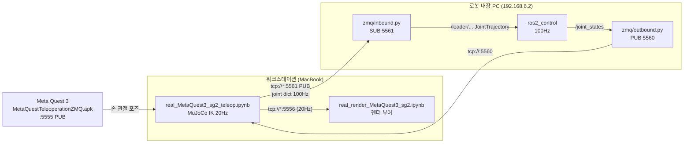

# VAI_test 워크스페이스 개요

FFW-SG2 기반 VLA / Robotics 연구를 위한 작업공간 구조 정리.
작성일: 2026-08-22 (연구실 실행 절차 반영: 2026-08-23)

실행만 하려면 **§7 실행 절차**부터 보면 된다.

---

## 1. 전체 구조

```text
VAI_test/
├── mkdown/            문서 저장소 (이 문서 위치)
├── ros2_ws/           로봇 내장 PC(Jetson AGX Orin)에서 도는 ROS 2 워크스페이스
└── ri_motion_v5_VR/   워크스테이션(Mac)에서 도는 MuJoCo + Quest 3 텔레오퍼레이션
```

두 워크스페이스는 **ROS 2 토픽이 아니라 ZMQ 소켓**으로 연결된다. 이것이 이 프로젝트의 핵심 설계 결정이다.

---

## 2. 하드웨어: FFW-SG2

ROBOTIS AI Worker 라인업 중 **스워브 드라이브 모바일 + 그리퍼** 사양.

| 항목 | 사양 |
|---|---|
| 총 DOF | 25 |
| 팔 | 7-DOF × 2 (arm_l / arm_r), 리치 641 mm (손목까지), 팔당 3 kg |
| 엔드이펙터 | RH-P12-RN 2지 그리퍼 × 2 (각 1-DOF 구동) |
| 헤드 | 2-DOF (head_joint1/2) |
| 리프트 | 1-DOF (lift_joint) |
| 모바일 베이스 | 스워브 드라이브 3모듈 (steer + drive × 3), 최대 1.5 m/s |
| 센서 | RGBD 카메라 × 3 (ZED mini + RealSense × 2), 2D LiDAR × 2, IMU |
| 온보드 PC | NVIDIA Jetson AGX Orin 32GB |
| 배터리 | 25 V / 80 Ah, 약 6시간 |
| 크기·무게 | 604 × 602 × 1,623 mm, 90 kg |

**모델 네이밍**: `FFW-{형태}{세대}` — S=Swerve(모바일), B=Base(고정), L=Leader(텔레오퍼레이션 마스터), 뒤의 G2/H5는 그리퍼(G) 세대2 / 핸드(H) 5지. 코드베이스에 SG2 외에 BG2(고정형), LG2(리더 암), SH5/BH5(다지 핸드) 설정이 함께 들어 있는 이유다.

---

## 3. ros2_ws — 로봇 내장 PC

### 3.1 패키지 구성

`ros2_ws/src/` 아래 10개 저장소:

| 패키지 | 역할 |
|---|---|
| **ai_worker** | ROBOTIS 공식 FFW 패키지 묶음 (핵심) |
| dynamixel_hardware_interface, DynamixelSDK, dynamixel_interfaces | DYNAMIXEL ros2_control 하드웨어 인터페이스 |
| robotis_interfaces | 공용 메시지 |
| realsense-ros, zed-ros2-wrapper | RGBD 카메라 드라이버 |
| Lakibeam_ROS2_Driver, dual_laser_merger | LiDAR × 2 + 병합 (`/scan_left`, `/scan_right` → `/scan`) |
| cyclo_control | 사이클로이드 감속기 모션 제어 |

`ai_worker` 내부:

- `ffw_bringup` — launch + 컨트롤러 YAML + 초기자세 YAML
- `ffw_description` — URDF/xacro, ros2_control xacro, 메시, Gazebo, RViz
- `ffw_moveit_config` — MoveIt 설정
- `ffw_swerve_drive_controller` — 스워브 드라이브 컨트롤러 (C++, odometry/speed_limiter 포함)
- `ffw_robot_manager` — 배터리·에러·LED 관리
- `ffw_joystick_controller`, `ffw_joint_trajectory_command_broadcaster`, `ffw_spring_actuator_controller` — 리더 장치 쪽 컨트롤러
- `ffw_navigation` — Nav2 + slam_toolbox 설정
- `ffw_teleop` — 키보드/모바일 텔레오퍼레이션
- `docker/` — s6-overlay 기반 서비스 자동 실행 (`ffw_sg2_follower_ai` 등)
- `zmq/` — **직접 추가한 ZMQ↔ROS 2 브리지** (§5)

### 3.2 SG2 하드웨어 인터페이스 (3계통 분리)

`ffw_sg2_follower.urdf.xacro` 는 ros2_control 시스템을 세 개로 나눈다:

| 시스템 | 포트 | 조인트 수 | 내용 |
|---|---|---|---|
| `ffw_sg2_follower` | `/dev/follower` | 22 | 양팔 14 + 그리퍼 8(구동 1 + 종동 3씩) + 헤드 2 + 리프트 1 |
| `ffw_sg2_base` | `/dev/ttyUSB0` | 3 | 스워브 3모듈 (steer는 position, drive는 velocity) |
| `ffw_sg2_sensor` | `/dev/ttyUSB1` | 0 | IMU 전용 (acc/gyro state interface) |

전부 baud 4,000,000, `disable_torque_at_init: true`.

### 3.3 컨트롤러

`ffw_sg2_follower_ai_hardware_controller.yaml`, update_rate **100 Hz**:

| 컨트롤러 | 타입 | 조인트 |
|---|---|---|
| `arm_l_controller` / `arm_r_controller` | JointTrajectoryController | arm_?_joint1~7 + gripper_?_joint1 (8개) |
| `head_controller` | JointTrajectoryController | head_joint1, head_joint2 |
| `lift_controller` | JointTrajectoryController | lift_joint |
| `swerve_drive_controller` | ffw_swerve_drive_controller | 휠 6 (steer 3 + drive 3) |
| `swerve_steering_initial_position_controller` | JointTrajectoryController | steer 3 (초기 정렬 후 unspawn) |
| `joint_state_broadcaster` | — | `/joint_states` |
| `ffw_robot_manager` | ffw_robot_manager | `ffw_type: ffw_sg2_rev1` |

스워브 파라미터 요점: 휠 반경 0.0825 m, 모듈 x 오프셋 [0.1371, 0.1371, −0.2899], y 오프셋 [0.2554, −0.2554, 0], 최단 조향 방향 flip 사용, odom은 SVD + Euler 적분.

### 3.4 부팅 시퀀스 (`ffw_sg2_follower_ai.launch.py`)

1. `ros2_control_node` + `robot_state_publisher` 기동
2. `joint_state_broadcaster` spawn
3. 팔·헤드·리프트 컨트롤러 spawn — **이때 명령 토픽을 리더 토픽으로 리맵**
   - `/arm_l_controller/joint_trajectory` ← `/leader/joint_trajectory_command_broadcaster_left/joint_trajectory`
   - `/arm_r_controller/joint_trajectory` ← `/leader/joint_trajectory_command_broadcaster_right/joint_trajectory`
   - `/head_controller/joint_trajectory` ← `/leader/joystick_controller_left/joint_trajectory`
   - `/lift_controller/joint_trajectory` ← `/leader/joystick_controller_right/joint_trajectory`
4. `joint_trajectory_executor` 로 초기 자세 이동 (`ffw_sg2_follower_initial_positions.yaml`)
5. 스워브 조향 정렬 → 초기 컨트롤러 unspawn → 5초 후 `swerve_drive_controller` spawn
6. +20초: 카메라(ZED → 10초 뒤 RealSense), LiDAR, `dual_laser_merger`

> **중요**: 3번의 리맵 때문에, 외부에서 로봇을 움직이려면 `/leader/...` 토픽에 `JointTrajectory` 를 쏘면 된다. 실제 LG2 리더 암이 없어도 동일하게 동작한다. `zmq/inbound.py` 가 정확히 이 지점을 노린다.

### 3.5 공식 저장소 대비 로컬 변경

브랜치 `jazzy`, HEAD `ae9b0b3` (ROBOTIS-GIT/ai_worker).

| 파일 | 변경 |
|---|---|
| `config/common/rs_serial.yaml` | RealSense 시리얼 → `315122272744`, `315122271898` (실기 교체) |
| `ffw_sg2_follower_initial_positions.yaml` | 팔 초기자세를 1스텝(전부 0) → **2스텝**으로 변경. step0 `[1.57, 0, 0, −2.8, 0, 0, 0, 0]` → step1 `[0, 0, 0, −1.57, 0, 0, 0, 0]`. 접힌 상태에서 안전하게 펴기 위한 시퀀스 |
| `zmq/` (untracked) | ZMQ 브리지 신규 추가 |
| 그 외 26개 파일 | **내용 변경 없음, 파일 권한(755→644)만 바뀜** |

> ⚠️ 권한 변경 대상에 `docker/s6-services/*/run`, `docker/container.sh` 등 **실행 스크립트가 포함**되어 있다. macOS 마운트를 거치며 exec 비트가 날아간 것으로 보이며, 이 상태로 로봇에 옮기면 s6 서비스가 실행되지 않을 수 있다. 필요 시 `git checkout` 또는 `chmod +x` 로 복구.

---

## 4. ri_motion_v5_VR — 워크스테이션 / VR

### 4.1 저장소 구조

```text
ri_motion_v5_VR/                       (Junha02/ri_motion_junha 포크)
├── ri_motion_v5_package/   [submodule] sjchoi86/ri_motion_v5_package — 재사용 파이썬 패키지
├── ri_motion_v5_asset/     [submodule] 공용 로봇/오브젝트 에셋
├── ri_motion_v5_notebook/  [submodule] 일반 예제 노트북
├── project/
│   └── ffw_sg2_vr_teleoperation/   ← 실질적인 유일한 프로젝트
├── bvh/                    모션캡처 데이터셋 (cmu_mocap, SeG_dataset)
├── code_convention.md      로컬 코딩 규칙
└── .venv-robotis-dexpilot/ (python3.14 — README의 conda 3.10 안내와 불일치)
```

> `project/` 아래 다른 프로젝트들(`ICRA_2027_MODULAR`, `T-FR_various_teleoperation_system`, `RLWRLD_2026_BMW_TMP` 등)은 **워킹트리에서 삭제된 상태(git status 상 D)**. README는 아직 옛 목록을 설명하고 있어 실제와 다르다.

### 4.2 `ri_motion_v5_package` 주요 모듈

| 모듈 | 내용 |
|---|---|
| `mujoco_sim` | `MuJoCoParser`, 드로잉, IK, 리플레이, 인터랙티브 마커, 프로세스 분리 렌더링, **nanobind C++ 확장** (`cpp/ik.cpp`, `signed_distance.cpp`) |
| `kinematics` | `transforms.py`(pr2t, t2r, r2quat, w2r …), numpy/screw 체인 |
| `utility` | `ZMQPubSub`, 필터, `SimpleTimer`, 시각화 |
| `qt` | `MultiRadioQtWidget` 등 뷰어 연동 위젯 |
| `motion_retarget`, `mocap` | BVH → 로봇 리타게팅 |
| `dpp`, `traj_optimization`, `gaussian_process` | 궤적 계획/최적화 |
| `leap2`, `vader5`, `hf_models`, `llm_clients` | 외부 하드웨어·모델 연동 |

`SOUL.md` 가 이 워크스페이스의 정식 스타일 문서이고, `code_convention.md` 는 로컬 보충 규칙이다.

### 4.3 `ffw_sg2_vr_teleoperation`

```text
ffw_sg2_vr_teleoperation/
├── package/
│   ├── init_project.py     sys.path 부트스트랩 + utils 심볼 주입 (%run 으로 호출)
│   ├── utils.py            1,954줄 — 이 프로젝트의 두뇌
│   └── worker/{inbound,outbound}.py   로봇 PC용 ZMQ 브리지 원본
├── sim_notebook/
│   ├── sim_MetaQuest3_sg2_teleop.ipynb          시뮬레이션 전용 프리뷰
│   └── sim_interactive_marker_wrist_ik_test.ipynb  기즈모로 손목 IK 테스트
├── real_notebook/
│   ├── real_MetaQuest3_sg2_teleop.ipynb   실기 명령 퍼블리셔
│   └── real_render_MetaQuest3_sg2.ipynb   별도 커널의 렌더 뷰어
└── xml/                    로컬 MJCF + STL 메시 (공용 에셋 폴더 불필요)
```

설계 방침: **핑거 리타게팅 없음**. SG2는 그리퍼이므로 Quest 손목 포즈 → 팔 IK만 풀고, 엄지-검지 핀치 거리로 그리퍼 개폐를 만든다.

#### utils.py 기능 축

- **Quest 패킷 파싱** — `QuestPalmRetargeting`. 헤더 3 float + 관절당 7 float(pos+quat). 좌팔 idx 2, 우팔 idx 28. Meta 좌표계 → MuJoCo 좌표계 변환 포함.
- **손목 프레임 정의** — `arm_?_link7` 기준 로컬 오프셋 `[0, 0, −0.08]` + 좌우 각각 다른 회전 보정.
- **어태치(attach) 상태 머신** — Quest 손목이 로봇 손목 근처(0.15 m)에 2.5~3초 머물면 부드럽게 결합. 결합 전엔 IK를 풀지 않는다. 급격한 손목 점프(>0.10 m)는 거부.
- **디태치 제스처** — 중지·약지·소지를 양손 모두 굽히고 1.2초 유지 → 어태치 해제. 히스테리시스(enter 0.45 / exit 0.28) 적용.
- **충돌 회피 IK** — `solve_sg2_collision_aware_wrist_ik`. 네이티브 C++ 백엔드(`build_sg2_collision_aware_ik_backend`)로 signed distance를 계산, safe margin 0.05 m, top-k 5. 양팔 14 조인트를 하나의 솔버에서 동시에 푼다.
- **그리퍼 매핑** — 핀치 거리 0.025 m(닫힘) ~ 0.095 m(열림) → 구동 조인트 qpos, EMA α=0.35.
- **메시지 레이아웃** — `build_q_msg_layout` 이 조인트 이름을 `lift / head / arm_l / arm_r / gripper_l / gripper_r` 그룹으로 나눠 ZMQ dict 를 만든다. 이 그룹 키가 로봇 쪽 `inbound.py` 의 키와 정확히 일치해야 한다.
- **오버레이/드로잉** — 어태치 진행률, 충돌 상태, IK 잔차, 그리퍼 상태를 뷰어에 표시.

#### 실기 루프 (`real_MetaQuest3_sg2_teleop.ipynb`)

3중 타이머 구조:

| 타이머 | 주기 | 하는 일 |
|---|---|---|
| `tmr_input` | 20 Hz | Quest 수신 → 어태치 갱신 → 제스처 판정 → 충돌회피 IK → 그리퍼 매핑 |
| `tmr_robot` | 100 Hz | `q_use` 를 ZMQ 로 로봇에 송신 |
| `tmr_render` | 20 Hz | 렌더 노트북으로 상태 + 오버레이 데이터 송신 |

**안전 게이트 3중**: Qt 위젯의 `Robot command` 토글이 ON + 최소 한 손이 어태치됨 + 손목 점프 미거부 — 셋 다 만족해야 로봇으로 명령이 나간다. 기본값은 OFF.

---

## 5. 두 워크스페이스의 연결 (ZMQ 브리지)

세 장치는 모두 **AI Worker의 Wi-Fi**에 붙어 있어야 한다.



### 포트/주소 표

| 역할 | 주소 | 방향 |
|---|---|---|
| Quest 3 손 트래킹 | `tcp://<Quest IP>:5555` (예: 192.168.6.100) | Quest PUB → Mac SUB |
| 로봇 명령 | `tcp://<Mac IP>:5561` | Mac PUB → 로봇 SUB (`inbound.py`) |
| 로봇 상태 | `tcp://192.168.6.2:5560` (고정) | 로봇 PUB (`outbound.py`) → Mac SUB |
| 렌더 미러 | `tcp://127.0.0.1:5556` | 노트북 PUB → 렌더 노트북 SUB |

노트북 상수: `SUB_FROM_SG2_IP = "192.168.6.2"`, `PUB_TO_SG2_IP = get_ip_address()`.
로봇 쪽 상수: `SG2_ZMQ_SUB_IP` 환경변수, 저장소 사본 기본값 `192.168.6.102` / 로봇 배포본 기본값 `192.168.6.100`.

> ⚠️ 위 표의 Quest·Mac IP는 **DHCP로 자주 바뀐다.** 실행 전마다 §7.2 체크리스트로 두 곳(노트북의 `ip_address_metaquest3`, 로봇의 `ZMQ_SUB_IP`)을 확인·수정해야 한다. 로봇 IP `192.168.6.2` 만 고정.

### inbound.py — 명령 주입

받은 dict 를 그룹별로 쪼개 4개 토픽으로 `JointTrajectory` 퍼블리시 (100 Hz, `time_from_start = 0`):

| dict 키 | 조인트 | 토픽 |
|---|---|---|
| `arm_l` + `gripper_l` | arm_l_joint1~7 + gripper_l_joint1 | `/leader/joint_trajectory_command_broadcaster_left/joint_trajectory` |
| `arm_r` + `gripper_r` | arm_r_joint1~7 + gripper_r_joint1 | `/leader/.../right/joint_trajectory` |
| `head` | head_joint1, head_joint2 | `/leader/joystick_controller_left/joint_trajectory` |
| `lift` | lift_joint | `/leader/joystick_controller_right/joint_trajectory` |

ZMQ 소켓은 `CONFLATE=1`, `HWM=1` — 항상 최신 한 개만 유지해 지연 누적을 막는다.

### outbound.py — 상태 회신

`/joint_states` 구독 → 6그룹으로 묶어 100 Hz PUB. `sensors` 필드는 현재 빈 dict (확장 여지).

> `ros2_ws/src/ai_worker/zmq/` 와 `ri_motion_v5_VR/.../package/worker/` 는 **동일한 파일의 사본**이다. 한쪽을 고치면 다른 쪽도 같이 고쳐야 한다. 향후 단일 소스화가 필요.

---

## 6. VLA 연구 관점에서의 현재 상태

**이미 갖춰진 것**

- 실기/시뮬 양쪽에서 동작하는 VR 텔레오퍼레이션 파이프라인 → **데이터 수집 경로 확보**
- 100 Hz 로봇 상태 스트림(`outbound.py`) + 100 Hz 명령 스트림(`inbound.py`) → **(state, action) 페어 로깅 지점이 명확**
- MuJoCo 디지털 트윈(`xml/ffw_sg2.xml`) + 충돌 회피 IK → **시뮬 롤아웃 / 정책 검증 환경**
- 안전 게이트(어태치, 점프 거부, 토글) → 실기 실험 안전장치

**아직 없는 것 / 확인 필요**

- 카메라 이미지가 텔레오퍼레이션 루프에 들어오지 않음. `outbound.py` 의 `sensors` 는 비어 있고, RGBD 3대는 ROS 2 쪽에만 존재 → **VLA 학습용 관측(observation) 수집 경로 미구현**
- LeRobot / `physical_ai_tools` 연동 흔적 없음 (ROBOTIS 공식은 이 경로를 권장)
- 에피소드 녹화·저장 포맷 없음
- 모바일 베이스(`swerve_drive_controller`)는 텔레오퍼레이션 루프에서 사용되지 않음. `/cmd_vel` 로 별도 제어
- `README.md`(양쪽 모두)가 실제 폴더 상태와 어긋남
- **IP 수동 관리**가 매 실행마다 필요(§7.2). 자동 디스커버리나 호스트명 기반 접속으로 바꾸면 실험 준비 시간이 줄어듦
- **`worker_*` alias가 저장소에 없음.** 컨테이너 재생성 시 유실되므로, alias 정의를 저장소로 옮기거나 launch/스크립트화하는 편이 안전

---

## 7. 실행 절차 (연구실 표준)

### 7.0 구성 요소 3개

| 장치 | 역할 |
|---|---|
| **Meta Quest 3** | `MetaQuestTeleoperationZMQ-debug.apk` 로 손 좌표 트래킹 → ZMQ PUB (5555) |
| **MacBook** | MuJoCo 시뮬 + 충돌회피 IK + 명령/렌더 퍼블리시 |
| **AI Worker 내장 PC** | ROS 2 브링업 + ZMQ 브리지 |

**세 장치 모두 AI Worker의 Wi-Fi에 접속되어 있어야 한다.** Quest 3도 포함.

### 7.1 최초 1회 세팅

#### (a) Mac → 로봇 SSH 등록

`~/.ssh/config` 에 추가:

```sshconfig
Host ffw-SNPR48A1115.local
    HostName ffw-SNPR48A1115.local
    User robotis
    ForwardX11 yes
```

#### (b) Mac 파이썬 환경

`ri_motion_v5_VR.zip` 을 받아 압축을 푼 뒤:

```bash
cd ri_motion_v5_package
conda create -n ri_motion_v5_env python=3.10 pip
conda activate ri_motion_v5_env
pip install -r requirements.txt
pip install -e .
```

#### (c) Jupyter 커널 등록

```bash
/opt/homebrew/Caskroom/miniforge/base/envs/ri_motion_v5_env/bin/python3 \
  -m ipykernel install --user --name ri_motion_v5_env --display-name ri_motion_v5_env
```

> 워크스페이스에 있는 `.venv-robotis-dexpilot` 은 python 3.14 로, 위 표준 절차(conda + 3.10)와 다르다. 노트북 커널은 `ri_motion_v5_env` 를 쓴다.

### 7.2 IP 체크리스트 — **매번 실행 전 확인**

Wi-Fi DHCP 때문에 IP가 자주 바뀐다. 두 곳을 고쳐야 한다.

| 고칠 곳 | 변수 | 넣을 값 |
|---|---|---|
| Mac: `real_MetaQuest3_sg2_teleop.ipynb` / `sim_MetaQuest3_sg2_teleop.ipynb` | `ip_address_metaquest3` | **Quest 3 의 현재 IP** |
| 로봇: `/home/robotis/ai_worker/zmq/inbound.py` | `ZMQ_SUB_IP` (기본값 `192.168.6.100`) | **MacBook 의 현재 IP** |

Mac IP는 노트북에서 `PUB_TO_SG2_IP = get_ip_address()` 로 자동 출력되므로, 그 값을 로봇 쪽에 반영하면 된다. `SUB_FROM_SG2_IP`(로봇 IP, `192.168.6.2`)는 고정.

> 로봇 쪽 `inbound.py` 는 배포 경로가 `/home/robotis/ai_worker/zmq/inbound.py` 이고, 이 저장소의 사본(`ros2_ws/src/ai_worker/zmq/inbound.py`)은 기본값이 `192.168.6.102` 로 되어 있어 서로 다르다. 어느 쪽을 고쳤는지 헷갈리기 쉬우니 주의.
>
> 매번 파일을 고치는 대신 실행 시 `SG2_ZMQ_SUB_IP=<Mac IP> python3 inbound.py` 로 환경변수를 주는 방법도 있다.

### 7.3 로봇 측 실행

1. `ffw-SNPR48A1115.local` 로 접속
2. VS Code에서 `⌘P` → `>` → **Attach to Running Container** → `ai_worker` 컨테이너 진입
3. `cd ros2_ws`
4. 터미널 3분할, **아래 순서대로**:

| 순서 | 명령(alias) | 내용 |
|---|---|---|
| 1 | `worker_bringup` | ROS 2 브링업. **완전히 끝날 때까지 대기** (초기 자세 이동 + 스워브 정렬 + 카메라/LiDAR까지 약 30초) |
| 2 | `worker_outbound` | 로봇 상태값 송신 (`outbound.py`) |
| 3 | `worker_inbound` | 로봇에 명령 주입 (`inbound.py`) — **시뮬 검증 후에 실행** |

> ⚠️ **`worker_inbound` 는 마지막에.** outbound까지만 띄운 상태에서 `sim_MetaQuest3_sg2_teleop.ipynb` 로 시뮬이 정상 동작하는지 먼저 확인하고, 그 다음에 inbound를 올린다. inbound가 떠 있으면 그 순간부터 로봇이 명령을 받는다.
>
> `worker_bringup` / `worker_outbound` / `worker_inbound` 는 **연구실에서 컨테이너 `~/.bashrc` 에 추가한 alias**로, 이 저장소의 Dockerfile에는 없다(저장소에는 `ffw_sg2_follower_ai` 등만 정의). 컨테이너를 새로 만들면 다시 등록해야 한다.

### 7.4 시뮬레이션 검증

`ri_motion_v5_VR/project/ffw_sg2_vr_teleoperation/sim_notebook/sim_MetaQuest3_sg2_teleop.ipynb`

Quest 트래킹이 들어오고 어태치·IK가 정상 동작하는지 확인. 여기서 문제가 있으면 실기로 넘어가지 않는다.

### 7.5 실기 실행

노트북 2개를 **각각 다른 커널**에서 실행 (실행 순서는 무관):

- `real_notebook/real_MetaQuest3_sg2_teleop.ipynb` — 명령 퍼블리셔
- `real_notebook/real_render_MetaQuest3_sg2.ipynb` — 렌더 뷰어

이후:

1. Quest 손목을 로봇 손목 근처(0.15 m)로 가져가 약 3초 유지 → **어태치**
2. Qt 위젯 `Robot command` → **ON** (기본 OFF)

### 7.6 🚨 안전 수칙

- **E-stop을 누를 사람을 반드시 한 명 옆에 둔다.** `Robot command` 를 ON 하는 순간부터.
- **로봇 출력이 생각보다 강하다.** 로봇 워크스테이션(작업대)을 찌그러뜨릴 수 있는 수준.
- 동작 범위 근처로 **사람이 지나다니지 않도록** 통제한다.
- 중지·약지·소지를 양손 모두 굽히고 1.2초 유지하면 **어태치가 해제**된다(소프트 정지). 하지만 이것은 E-stop의 대체가 아니다.

---

## 8. 참고

- [ROBOTIS AI Worker 문서](https://docs.robotis.com/docs/systems/aiworker/introduction/)
- [AI Worker 하드웨어 사양](https://ai.robotis.com/ai_worker/hardware_ai_worker)
- [FFW-SG2 제품 페이지](https://www.robotis.us/ai-worker-ffw-sg2-us/)
- [ROBOTIS-GIT/ai_worker](https://github.com/ROBOTIS-GIT/ai_worker)
- [ROBOTIS-GIT/physical_ai_tools](https://github.com/ROBOTIS-GIT/physical_ai_tools)
