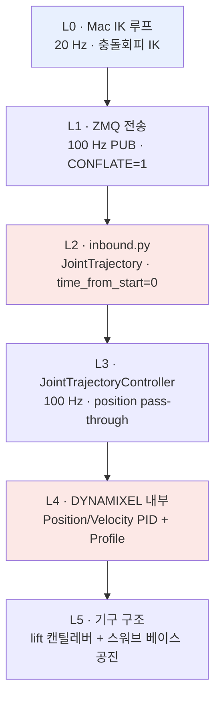

# 01. Gain Tuning & Kalman Filter — 본체 떨림 해결

FFW-SG2에 FK(관절각) 명령을 주었을 때 **로봇 본체가 크게 떨리는 문제**를 잡기 위해, 명령 체인의 어느 계층에서 무엇을 고쳐야 하는지 정리한 문서.

작성일: 2026-08-23 · 로봇 상태: 초기(공식 설정 그대로) · 관련 문서: [00_workspace_overview.md](./00_workspace_overview.md)

---

## 1. 문제 정의

- **증상**: FK 명령 입력 시 관절뿐 아니라 **로봇 본체(base/lift)가 크게 떨림**
- **의미**: 단일 관절의 오버슛이 아니라, 상체 관성이 리프트 기둥과 모바일 베이스로 전달되는 **구조 진동**. 팔 관절 하나만 튜닝해서 해결되지 않을 가능성이 높다.
- **구조적 배경**: base 36 kg 위에 lift 17.9 kg + 상체가 얹혀 있는 **높은 무게중심의 캔틸레버**(전고 1,623 mm). 스워브 휠 3개는 서스펜션이 없어 상체 토크가 바닥으로 그대로 전달된다.

### 떨림의 두 종류를 먼저 구분할 것

| 유형 | 관측 | 원인 계층 | 대응 |
|---|---|---|---|
| **A. 명령이 이미 떨림** | `Goal Position` 자체가 진동 | L0~L2 (Mac IK, 전송) | Kalman/보간 (§5) |
| **B. 명령은 매끈한데 추종이 떨림** | `Goal Position` 매끈, `Present Position`/`Present Current` 진동 | L3~L5 (JTC, DXL PID, 구조) | Gain/Profile 튜닝 (§4) |

> **§3의 계측을 먼저 하고 A/B를 판정한 뒤 §4 또는 §5로 갈 것.** 순서를 바꾸면 두 곳을 동시에 흔들어 원인을 못 찾는다.

---

## 2. 명령 체인 계층 지도

떨림이 만들어질 수 있는 지점은 6군데다.



| 계층 | 현재 설정 | 떨림 기여 가능성 |
|---|---|---|
| **L0** | IK 20 Hz, 스무딩 없음 | **높음** — 20 Hz 이산 해가 100 Hz로 나가면서 **ZOH 계단 입력** 발생 (5개 틱마다 계단) |
| **L1** | `CONFLATE=1`, `HWM=1`, 100 Hz | 중간 — 최신값만 유지하므로 지연은 적으나, 드롭 시 계단 폭이 커짐 |
| **L2** | `time_from_start = Duration(0,0)`, `header.stamp = 0` | **매우 높음** — "지금 즉시 도달"이라 JTC가 사실상 **스텝 입력**을 만든다 |
| **L3** | `command_interfaces: [position]`, gains 블록 없음 | 낮음(직접) — position 인터페이스에서 JTC는 PID를 돌리지 않고 보간만 함. 단 `allow_nonzero_velocity_at_trajectory_end: true` 가 끝점에서 속도를 남긴다 |
| **L4** | Position P `1,583,185` 등 (§4.1) | **높음** — 고이득 + Profile Time 짧음 |
| **L5** | — | 높음 — L0~L4가 만든 여기(excitation)를 증폭 |

---

## 3. 계측 — 먼저 숫자로 본다

튜닝 전에 반드시 기준선을 잡는다. **감으로 gain을 바꾸면 되돌아갈 수 없다.**

### 3.1 기록할 신호

로봇 측에서:

```bash
ros2 topic hz /joint_states                 # 실제 상태 주기 확인 (100 Hz 나오는가)
ros2 topic hz /leader/joint_trajectory_command_broadcaster_left/joint_trajectory
ros2 bag record -o shake_baseline \
  /joint_states \
  /leader/joint_trajectory_command_broadcaster_left/joint_trajectory \
  /leader/joint_trajectory_command_broadcaster_right/joint_trajectory \
  /ffw_follower/dxl_state \
  /imu                                       # 본체 진동의 직접 증거
```

> **IMU가 핵심 계측기다.** 본체 떨림이 문제이므로, 관절 데이터보다 base IMU의 가속도 스펙트럼이 더 직접적인 지표다. `ffw_sg2_sensor.ros2_control.xacro` 가 IMU를 `/dev/ttyUSB1` 에서 state interface로 노출한다. 토픽 이름은 `ros2 topic list` 로 확인할 것.

### 3.2 판정 기준

| 확인 | 방법 | 해석 |
|---|---|---|
| 명령 자체의 떨림 | `JointTrajectory.points[0].positions` 시계열 FFT | 피크가 있으면 **유형 A** → §5 |
| 추종 오차 | `Present Position − Goal Position` | 진동하면 **유형 B** → §4 |
| 진동 주파수 | IMU acc FFT | 20 Hz 근처 = L0 IK 주기 aliasing / 그보다 높으면 = L4 PID 또는 L5 공진 |
| 전류 진동 | `Present Current` | 크게 진동하면 gain 과도 (L4) |

**진동 주파수가 20 Hz 부근이면 gain을 건드리기 전에 §5(명령 스무딩)부터 해야 한다.** IK 루프 주기가 그대로 여기 주파수로 찍히는 것이기 때문이다.

---

## 4. Gain / Profile 튜닝 — 로봇 측

### 4.1 현재 gain 전수 표

**파일**: `ros2_ws/src/ai_worker/ffw_description/ros2_control/ffw_sg2_rev1_follower/ffw_sg2_follower.ros2_control.xacro`

`<gpio>` 블록은 URDF의 `<joint>` 선언 **순서대로** 매핑된다.

| 관절 | gpio / ID | Pos P | Vel P | Vel I | Pos FF | Profile Vel / Acc | Prof AccTime / Time |
|---|---|---|---|---|---|---|---|
| `arm_r_joint1~3` | dxl1~3 | 1,583,185 | 41,387 | 1,565,630 | 100 | 3591 / 3591 | 250 / 500 |
| `arm_r_joint4~6` | dxl4~6 | 1,583,185 | 18,184 | 1,585,331 | 100 | 6486 / 3591 | 250 / 500 |
| `arm_r_joint7` | dxl7 | — | — | — | — | 100 / 50 | — |
| `gripper_r_joint1` | dxl8 | — | — | — | — | 0 / 0 | — |
| `arm_l_joint1~3` | dxl31~33 | 1,583,185 | 41,387 | 1,565,630 | 100 | 3591 / 3591 | 250 / 500 |
| `arm_l_joint4~6` | dxl34~36 | 1,583,185 | 18,184 | 1,585,331 | 100 | 6486 / 3591 | 250 / 500 |
| `arm_l_joint7` | dxl37 | — | — | — | — | 100 / 50 | — |
| `gripper_l_joint1` | dxl38 | — | — | — | — | 0 / 0 | — |
| **`lift_joint`** | **dxl81** | **1,583,185** | **41,387** | **1,065,630** | — | **300 / 300** | **250 / 500** |
| `head_joint1` | dxl61 | 1,600 | — | — | FF1 30 / FF2 30 | 100 / 50 | — |
| `head_joint2` | dxl62 | 800 | — | — | FF1 20 / FF2 20 | 100 / 50 | — |
| `*_wheel_steer` | dxl101/103/105 | — | — | — | — | 12592 / — | 500 / 1000 |

**두 가지 gain 체계가 섞여 있다는 점에 주의:**

- **팔·리프트·조향** — YM 계열 4-byte gain (`Position P Gain` 백만 단위). 컨트롤 테이블: `ffw_sg2_steer_*.model`, `ym*.model`
- **헤드** — XM/XH 계열 2-byte gain (`Position P/I/D Gain` 수백~수천 단위) + `Feedforward 1st/2nd Gain`. 컨트롤 테이블: `h54_*.model`, `xm430_*.model`
- `head_joint1/2`만 **Position D Gain / I Gain**을 쓰고, 팔은 **Velocity P/I + Position FF** 구조다. 같은 이름으로 묶어 생각하면 안 된다.

> 리프트만 `Velocity I Gain`이 `1,065,630` 으로 팔(`1,565,630`)보다 **낮게** 설정되어 있고 `Position FF Gain`이 없다. 본체 떨림이 문제라면 **여기를 가장 먼저 의심**할 것.

### 4.2 코드 없이 먼저 해볼 것 ①: `smooth` 프로파일로 전환

저장소에 **이미 완만한 프로파일 버전이 존재한다.**

**파일**: `ffw_sg2_follower_smooth.ros2_control.xacro` (같은 폴더)

`ffw_sg2_follower.ros2_control.xacro` 와의 차이는 오직 프로파일 시간뿐 (gain은 동일):

| 파라미터 | 기본 | smooth |
|---|---|---|
| `Profile Acceleration Time` | 250 | **750** |
| `Profile Time` | 500 | **1500** |
| `Profile Velocity` (joint7) | 100 | **300** |
| `Profile Acceleration` (joint7) | 50 | **150** |

전환은 **launch 인자 하나**로 끝난다 (파일 수정 불필요):

```bash
ros2 launch ffw_bringup ffw_sg2_follower_ai.launch.py ros2_control_type:=ffw_sg2_follower_smooth
```

> `ffw_sg2_follower_ai.launch.py` 의 `ros2_control_type` 기본값이 `ffw_sg2_follower` 이고, 이 값이 `ffw_sg2_follower.urdf.xacro` 의 include 경로로 그대로 들어간다.
>
> `worker_bringup` alias를 쓰고 있다면 alias 정의에 이 인자를 추가하거나, 한 번은 전체 명령을 직접 입력한다.

**가장 먼저 이것부터 시도할 것.** 코드 변경 0줄로 L4 프로파일이 3배 완만해지므로, 떨림이 프로파일 때문인지 gain 때문인지 즉시 갈린다.

### 4.3 코드 없이 먼저 해볼 것 ②: 런타임 gain 스윕

`dynamixel_hardware_interface` 가 **런타임 읽기/쓰기 서비스**를 노출한다. 재빌드·재브링업 없이 gain을 바꿔가며 떨림을 볼 수 있다.

```bash
# 현재값 확인
ros2 service call /ffw_follower/get_dxl_data dynamixel_interfaces/srv/GetDataFromDxl \
  "{id: 81, item_name: 'Velocity I Gain', timeout_sec: 1.0}"

# 값 변경 (리프트 Velocity I Gain 을 절반으로)
ros2 service call /ffw_follower/set_dxl_data dynamixel_interfaces/srv/SetDataToDxl \
  "{id: 81, item_name: 'Velocity I Gain', item_data: 500000}"
```

- `item_name` 은 `.model` 파일의 **Data Name과 정확히 일치**해야 한다 (대소문자·공백 포함).
- 서비스 이름은 하드웨어 파라미터 `set_dynamixel_data_srv_name: ffw_follower/set_dxl_data` 에서 온다. 실제 이름은 `ros2 service list | grep dxl` 로 확인.
- 이 값들은 **RAM 영역**이므로 재부팅하면 초기화된다 → 실험에는 안전, 확정되면 xacro에 반영.
- 베이스(휠) 쪽은 `ffw_base/set_dxl_data`, 센서는 `ffw_sensor/set_dxl_data` 로 분리되어 있다.

> ⚠️ gain을 낮추면 팔이 **처진다**. 리프트와 어깨(joint1~3)는 중력 부하를 받으므로 `Position P Gain` 을 크게 낮추면 상체가 내려앉는다. **낮추는 실험은 팔을 안전 자세로 접고, E-stop 옆에 두고** 진행할 것.

### 4.4 gain 튜닝 순서

떨림이 유형 B로 판정된 경우:

1. **`Profile Acceleration Time` / `Profile Time` 을 먼저 늘린다** (§4.2). 가장 안전하고 효과가 큼.
2. **`Velocity I Gain` 을 낮춘다.** I항이 크면 저주파 리미트 사이클을 만든다. 리프트(dxl81) → 어깨(dxl1/2/3, 31/32/33) 순서.
3. **`Velocity P Gain` 을 낮춘다.** 고주파 떨림이 남아 있으면.
4. **`Position FF Gain`(100) 을 낮추거나 0으로.** FF는 명령이 매끈하다는 전제에서만 도움이 된다 — 명령이 계단이면 FF가 **떨림을 증폭**한다. §5를 하기 전이라면 이것부터 0으로 시험해볼 가치가 있다.
5. `Position P Gain` 은 마지막에. 낮추면 추종 정확도와 중력 지지력이 같이 떨어진다.
6. 헤드(dxl61/62)는 별도 체계 — `Position D Gain` 을 올리는 쪽이 떨림에 효과적일 수 있다(팔과 반대 방향의 조작).

**한 번에 한 파라미터, 한 관절씩.** 매 변경마다 §3.1의 bag을 다시 뜬다.

### 4.5 확정된 값을 코드에 반영

| 파일 | 수정 내용 |
|---|---|
| `ffw_description/ros2_control/ffw_sg2_rev1_follower/ffw_sg2_follower.ros2_control.xacro` | 해당 `<gpio>` 블록의 `<param name="... Gain">` 값 교체 |
| (선택) 같은 폴더에 `ffw_sg2_follower_tuned.ros2_control.xacro` 신규 | 원본을 보존하고 `ros2_control_type:=ffw_sg2_follower_tuned` 로 전환. **권장** — 공식 설정과의 diff가 명확해짐 |
| `ffw_bringup/launch/ffw_sg2_follower_ai.launch.py` | 새 프로파일을 기본값으로 쓸 경우 `ros2_control_type` 의 `default_value` 변경 |

변경 후:

```bash
cd ~/ros2_ws && colcon build --symlink-install --packages-select ffw_description ffw_bringup
source install/setup.bash
```

---

## 5. Kalman Filter / 명령 스무딩 — 워크스테이션 측

### 5.1 왜 필요한가

현재 실기 루프는 이렇게 동작한다:

```
IK 20 Hz 로 q_use 갱신  →  같은 값을 100 Hz 로 5번 반복 송신  →  20 Hz 계단파
```

`real_MetaQuest3_sg2_teleop.ipynb` 의 `tmr_input`(20 Hz)과 `tmr_robot`(100 Hz)이 분리되어 있고, **그 사이에 보간이나 필터가 없다.** 게다가 상류의 Quest 손 추적 자체가 노이즈를 갖는다.

즉 **로봇에게 20 Hz 사각파를 먹이고 있는 상태**다. L4의 gain이 아무리 좋아도 이건 못 이긴다.

### 5.2 이미 있는 자산 — 새로 짤 필요 없음

**파일**: `ri_motion_v5_package/utility/filters.py`

```python
class VectorizedKalmanFiltersFast(object):
    def __init__(self, shape, dt=0.05, q=0.1, r=1.0,
                 q_mode="acc", dtype=np.float32, p0=10.0)
    def update(self, obs, reset=False)   # obs: shape 그대로, 반환도 shape 그대로
```

- 상태는 `[pos, vel]^T`, 다수의 1D 신호를 벡터화해 한 번에 처리
- **선례**: `ri_motion_v5_package/leap2/leap2_handler.py:351` 에서 Leap Motion 손 본 (5,4,2,3) 에 `dt=1/120, q=0.01, r=5.0` 로 이미 사용 중
- `q` ↑ = 반응 빠름/노이즈 통과, `r` ↑ = 부드러움/지연 증가

`from ri_motion_v5_package.utility import *` 로 이미 노트북에 로드되어 있다.

### 5.3 필터를 어디에 넣을 것인가 — 3가지 후보

| 후보 | 위치 | 필터 대상 | 장점 | 단점 |
|---|---|---|---|---|
| **(a) 입력단** | `utils.py: update_metaquest3_wrist_data()` | Quest 손목 포즈 (4×4 T) | 노이즈 원천 제거, IK 입력이 매끈해짐 | 회전 성분 필터링에 주의 필요 (R 행렬을 그대로 KF에 넣으면 직교성 깨짐 → 위치만 필터하거나 quaternion으로 변환) |
| **(b) 출력단** | 노트북 메인 루프, `pub_robot.send()` 직전 | 관절각 `q_use` (22-vector) | 구현 단순, 회전 문제 없음, 효과 직접적 | IK 이후라 팔 자세의 불연속(특이점 근처 점프)은 못 막음 |
| **(c) 업샘플링** | `tmr_robot` 블록 | 20 Hz → 100 Hz 보간 | 계단파 제거의 정공법 | 지연 1틱(50 ms) 추가 |

> **권장 순서: (b) → (c) → (a).**
> (b)가 가장 적은 코드로 가장 큰 효과를 내고, 되돌리기도 쉽다. (c)는 (b)와 함께 쓰면 계단이 완전히 사라진다. (a)는 회전 처리 설계가 필요하므로 나중에.

### 5.4 수정 대상 파일

| 파일 | 무엇을 |
|---|---|
| `project/ffw_sg2_vr_teleoperation/package/utils.py` | 필터 생성/적용 헬퍼를 추가. 노트북 셀에 KF 객체를 직접 노출하지 말 것 — **코드 컨벤션**상 노트북은 `create_sg2_command_filter(...)` / `filter_sg2_command_qpos(...)` 같은 의미 있는 헬퍼만 보여야 한다 |
| `.../real_notebook/real_MetaQuest3_sg2_teleop.ipynb` cell 6 | 필터 객체 생성 (설정 셀) |
| `.../real_notebook/real_MetaQuest3_sg2_teleop.ipynb` cell 7 | 메인 루프에서 `q_use` 에 필터 적용 |
| `.../sim_notebook/sim_MetaQuest3_sg2_teleop.ipynb` cell 5·6 | 동일 변경 — **시뮬에서 먼저 검증** |
| (선택) `package/worker/inbound.py` + `ros2_ws/src/ai_worker/zmq/inbound.py` | 로봇 측 보간을 넣을 경우. **두 파일은 사본이므로 반드시 같이 수정** |

### 5.5 코드 컨벤션 준수 사항

`ri_motion_v5_VR/code_convention.md` 및 `ri_motion_v5_package/SOUL.md` 기준:

- 노트북 셀에 `import sys`, `sys.path` 조작, vendor 직접 import 금지 → `utils.py` 안에 숨긴다
- 리터럴 하나를 함수 인자로 넘기려고 변수를 만들지 않는다 → `kf_r=5.0` 처럼 호출부에 직접 쓴다
- 하나의 개념이 여러 키를 제어하면 의미 있는 파라미터 하나로 노출한다 → 예: `smoothing="kalman"` / `"ema"` / `None`

### 5.6 대안 / 병행 검토

- **EMA (지수이동평균)** — 이미 선례가 있다. `update_sg2_gripper_from_quest_pinch(..., smoothing_alpha=0.35)` 가 그리퍼에 EMA를 쓰고 있다. KF보다 훨씬 단순하므로 **A/B 비교 기준선**으로 먼저 넣어볼 가치가 있다.
- **IK 주기 상향** — `input_hz = 20` 을 30~50으로 올리면 계단 자체가 잘아진다. 다만 충돌회피 IK의 계산 시간이 병목일 수 있으므로 `SimpleTimer.get_lag_info()` 로 실제 lag을 먼저 확인할 것.
- **`time_from_start` 부여** — §6 참조. 필터보다 이쪽이 더 근본적일 수 있다.

---

## 6. `inbound.py` — 가장 의심스러운 한 줄

**파일**: `ros2_ws/src/ai_worker/zmq/inbound.py` (= `ri_motion_v5_VR/.../package/worker/inbound.py`, 로봇 배포본은 `/home/robotis/ai_worker/zmq/inbound.py`)

```python
msg.header.stamp.sec = 0
msg.header.stamp.nanosec = 0
...
point.time_from_start = Duration(sec=0, nanosec=0)   # ← 여기
msg.points = [point]
```

**단일 포인트 + `time_from_start = 0`** 은 JTC에게 "이 위치로 지금 즉시 가라"는 뜻이다. 100 Hz로 매번 새 궤적이 들어오면서 JTC는 매 사이클 스텝 명령을 받는다. 보간 구간이 존재하지 않는다.

### 시도해볼 변경

| 변경 | 기대 효과 | 리스크 |
|---|---|---|
| `time_from_start` 를 `1/PUBLISH_HZ` (10 ms) 이상으로 | JTC가 실제로 보간 구간을 갖게 됨 | 값이 너무 크면 지연·뒤처짐 |
| 2-포인트 궤적 (현재 상태 → 목표) | 속도 프로파일이 생김 | `/joint_states` 를 inbound에서도 구독해야 함 |
| `allow_nonzero_velocity_at_trajectory_end: false` (컨트롤러 yaml) | 궤적 끝에서 속도를 0으로 강제 | 연속 명령에서 매번 감속 → 끊김 |

> `ffw_sg2_follower_ai_hardware_controller.yaml` 의 `allow_nonzero_velocity_at_trajectory_end: true` 는 연속 텔레오퍼레이션을 위한 설정이다. **끄면 떨림은 줄지만 움직임이 끊길 수 있다** — 트레이드오프를 계측으로 확인할 것.

> ⚠️ `inbound.py` 는 저장소 사본과 로봇 배포본이 **경로도 기본 IP도 다르다**([00 문서 §7.2](./00_workspace_overview.md)). 어느 파일을 고쳤는지 반드시 확인하고, 확정 후 양쪽을 동기화할 것.

---

## 7. 수정 대상 파일 총괄

| # | 파일 | 계층 | 변경 성격 | 우선순위 |
|---|---|---|---|---|
| 1 | (없음) `ros2_control_type:=ffw_sg2_follower_smooth` | L4 | launch 인자만 | **1 — 즉시** |
| 2 | (없음) `ros2 service call .../set_dxl_data` | L4 | 런타임 스윕 | **2 — 즉시** |
| 3 | `.../real_MetaQuest3_sg2_teleop.ipynb` + `package/utils.py` | L0 | KF/EMA 추가 | **3** |
| 4 | `.../sim_MetaQuest3_sg2_teleop.ipynb` | L0 | 동일 (검증용) | 3과 동시 |
| 5 | `ros2_ws/src/ai_worker/zmq/inbound.py` (+ `package/worker/inbound.py`) | L2 | `time_from_start` | **4** |
| 6 | `ffw_sg2_follower.ros2_control.xacro` (또는 `_tuned` 신규) | L4 | gain 확정값 반영 | 5 — 값이 정해진 뒤 |
| 7 | `ffw_sg2_follower_ai_hardware_controller.yaml` | L3 | `allow_nonzero_velocity_at_trajectory_end` | 6 — 최후 |
| 8 | `ffw_bringup/launch/ffw_sg2_follower_ai.launch.py` | — | `ros2_control_type` 기본값 | 7 — 확정 후 |

---

## 8. 작업 체크리스트

```text
[ ] 0. 기준선 bag 기록 (§3.1) — IMU 포함. 파일명에 날짜/조건 명시
[ ] 1. FFT로 유형 A/B 판정 (§3.2)
[ ] 2. ros2_control_type:=ffw_sg2_follower_smooth 로 재브링업 → 재측정
[ ] 3. (유형 B) 런타임 서비스로 lift dxl81 Velocity I Gain 스윕 → 재측정
[ ] 4. (유형 A) 시뮬에서 EMA 먼저 적용 → 계단 사라지는지 확인
[ ] 5. 시뮬 OK 후 실기에 KF 적용 (E-stop 대기 필수)
[ ] 6. inbound.py time_from_start 실험
[ ] 7. 확정값을 xacro / 노트북 / utils.py 에 반영, 두 inbound.py 동기화
[ ] 8. 변경 전후 bag 비교 그래프를 mkdown/ 에 기록
```

---

## 9. 안전

- **gain을 낮추는 실험은 팔을 접은 자세에서.** 어깨·리프트 gain을 낮추면 중력으로 상체가 내려앉는다.
- 튜닝 중에는 **`Robot command` OFF 상태에서 초기자세 이동만으로** 떨림을 재현하는 것이 안전하다. 텔레오퍼레이션을 켤 필요가 없다.
- 런타임으로 바꾼 gain은 **재부팅 시 초기화**된다. 이상한 상태에 빠지면 재브링업이 가장 빠른 복구.
- E-stop 담당자 배치는 [00 문서 §7.6](./00_workspace_overview.md) 과 동일하게 적용.

---

## 10. 미해결 / 확인 필요

- IMU 토픽 이름과 발행 여부 (`ffw_sg2_sensor` 시스템이 실제로 IMU를 퍼블리시하는지 실기에서 확인)
- `Drive Mode` 값의 의미 (68/69/4/5가 혼재 — 반전·프로파일 설정 비트로 보이나 확인 필요)
- 떨림이 **특정 자세에서만** 나는지 (팔을 펼쳤을 때만이라면 관성 모멘트 문제 → gain보다 궤적 계획 쪽)
- 리프트 높이에 따른 떨림 변화 (공진 주파수가 높이에 따라 변하면 L5 구조 문제 확정)
- 스워브 휠이 접지 상태인지, 브레이크가 걸린 상태인지 (`swerve_drive_controller` 활성 여부에 따라 베이스 강성이 달라짐)
